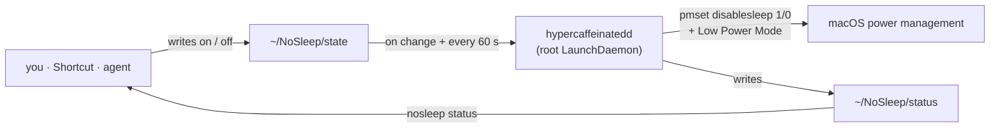

# ☕☕☕ hypercaffeinated

> **Your Mac gets no sleep.** Not with the lid closed. Not on battery. Not even in your backpack.

<p align="center">
  
</p>

`caffeinate` keeps your Mac awake while you sit in front of it.
**hypercaffeinated** keeps it awake after you close the lid, unplug it and walk out the door, so
your coding agent keeps working in the bag and you keep steering it from your phone.

> [!WARNING]
> **Experimental.** A laptop that can't sleep, inside a bag, gets warm and drains its battery.
> Read [Before you put a running laptop in a bag](#%EF%B8%8F-before-you-put-a-running-laptop-in-a-bag) first.

---

## Why would anyone want this?

The use case that started it all:

```text
09:41  you     "Claude, refactor the auth module and get the tests green."
09:42  you     nosleep on
09:42  you     *closes lid, laptop into bag, leaves for the train*
09:55  phone   Claude Code Remote Control: "also open a draft PR when it's done"
10:20  mac     *quietly ships it from inside your backpack*
10:21  claude  ~/NoSleep/nosleep off   ← lets the Mac finally sleep
```

Normally, closing the lid puts the Mac to sleep: the session pauses, Remote Control drops, and
nothing happens until you open it again. With hypercaffeinated the Mac stays awake with the
lid shut: screen off, network on, agent busy.

Also handy for:

- long downloads, uploads, backups or test runs that shouldn't die when you close the lid
- staying reachable over SSH / Tailscale while the laptop is closed in a bag
- a closed MacBook acting as a small home server for an evening

## "But… `caffeinate` exists?"

It does, and it's great, until you close the lid. Here's the coffee menu:

|                                                         | `caffeinate`              | raw `sudo pmset -a disablesleep 1`   | **hypercaffeinated**          |
| ------------------------------------------------------- | ------------------------- | ------------------------------------ | ----------------------------- |
| Stays awake with the **lid closed, on battery**         | ❌ the lid wins (`-s` only works on AC) | ✅                         | ✅                            |
| Toggle **without a sudo password**, so an agent or a Shortcut can do it | ✅              | ❌ needs sudo every time              | ✅ writes one word to a file  |
| **Turns itself off at low battery**                     | ❌                        | ❌                                   | ✅ at 20 % (configurable)     |
| **Turns itself off when the Mac runs hot**              | ❌                        | ❌                                   | ✅ at thermal state *serious* |
| **Turns itself off after a max time**                   | only with `-t`            | ❌ forget it once, cook it all weekend | ✅ after 12 h (configurable) |
| Switches on **Low Power Mode** to run cooler            | ❌                        | ❌                                   | ✅ and restores your setting  |
| Survives the terminal / agent session ending            | ❌ dies with its process  | ✅ even across reboots (scary)        | ✅ with guardrails            |

In short: `caffeinate` is an espresso. Raw `pmset disablesleep` is drinking from the
espresso machine. hypercaffeinated is the same machine with a lid, a timer and someone who cuts
you off at 20 % battery.

## ⚠️ Before you put a running laptop in a bag

This is the part to actually read.

- **🔥 Heat.** A bag has almost no airflow. A busy Mac in a bag (compiling, running local models,
  Spotlight indexing after an update) can get properly hot. Fanless MacBook Airs throttle; Macs
  with fans can still get hot inside a padded sleeve. Heat also ages your battery.
  - Low Power Mode is switched on automatically while No-Sleep is on.
  - The thermal guard turns No-Sleep off when macOS reports a *serious* or *critical* thermal state,
    and puts the Mac to sleep right away if the lid is closed. It's a backstop, not a guarantee:
    it checks about once a minute, and `ProcessInfo.thermalState` is a coarse system-wide signal,
    **not a battery temperature reading**. Heat can still harm a battery before it trips.
  - Keep the work light: agent turns, edits, tests. Not a 40-minute Xcode build or a 70B model.
  - Prefer an open sleeve or outer pocket. Don't bury it under a jacket. **Never in a hot car.**
  - Check it when you arrive. Hot to the touch? Take it out and turn No-Sleep off.
- **🔋 Battery.** No sleep means it drains roughly like an open Mac with the screen off.
  The guard turns No-Sleep off at 20 %, and then the Mac goes back to sleep.
- **📶 Network.** Your agent needs internet in the bag. When you leave the office Wi-Fi the Mac
  has to join something else: turn on Personal Hotspot on your phone and let the Mac join it
  automatically (System Settings → Wi-Fi → *Ask to join hotspots* → *Automatic*).
- **🧪 Undocumented flag.** `pmset disablesleep` isn't in `man pmset`. It has worked for years, but
  Apple can change it in any update.
- **♻️ It persists.** The setting survives reboots until something turns it off. The daemon handles
  that for you. If you ever delete the daemon by hand, run `sudo pmset -a disablesleep 0`.

Developed and used on an Apple Silicon MacBook Pro with macOS 26. Older Macs that use the
`lowpowermode` key are handled too, but less tested. No warranty: [MIT](LICENSE), your hardware,
your call.

## Install

```bash
git clone https://github.com/n-athana/hypercaffeinated
cd hypercaffeinated
less install.sh            # it installs a root daemon, so read it first (about 240 lines)
sudo bash install.sh       # defaults: auto-off at 20 % battery or after 12 h, thermal guard always on
```

More careful:

```bash
sudo bash install.sh --min-batt 40 --max-hours 3
```

Optional, so you can type `nosleep` from anywhere:

```bash
echo 'alias nosleep="$HOME/NoSleep/nosleep"' >> ~/.zshrc
```

## Use

```console
$ nosleep on
☕ No-Sleep ON since 24.11. 09:42 · thermal: nominal · checked 09:42:07

$ nosleep status
☕ No-Sleep ON since 24.11. 09:42 · thermal: nominal · checked 09:43:07

$ nosleep off
😴 No-Sleep OFF, normal sleep · thermal: nominal · checked 10:21:03

$ nosleep status        # after a guard stepped in
😴 No-Sleep OFF, normal sleep (auto-off: battery at 20%) · thermal: nominal · checked 11:02:41

$ nosleep status        # after the thermal guard stepped in
😴 No-Sleep OFF, normal sleep (auto-off: thermal state serious) · thermal: fair · checked 14:15:09
```

`nosleep toggle` flips it. That's the whole interface.

**One-click toggle:** in the Shortcuts app, create a shortcut with a *Run Shell Script* action
running `~/NoSleep/nosleep toggle`, then pin it to the menu bar or give it a keyboard shortcut.

## Let your agent flip the switch

Because toggling needs no password, your agent can do it. That includes turning it **off** when the
work is done, so the Mac goes to sleep in your bag instead of cooking. Paste this into
`~/.claude/CLAUDE.md` (Claude Code) or an `AGENTS.md`:

```markdown
## Staying awake (hypercaffeinated)
- `~/NoSleep/nosleep on|off|status` keeps this Mac awake with the lid closed. No sudo needed.
- When I say I'm heading out, going mobile, or "keep working while I walk":
  run `~/NoSleep/nosleep on` and show me the status line.
- When I'm away and the task is finished, run `~/NoSleep/nosleep off`, then tell me.
  After that the Mac will sleep and I can't reach you until I open it.
- While it's on, assume the laptop is in a bag: avoid heavy builds or local models unless I ask.
```

## How it works



1. You (or anything running as you) write `on` or `off` into `~/NoSleep/state`.
2. A root LaunchDaemon wakes up when that file changes, and every 60 s anyway.
3. Switching **on**, it saves your current power mode, turns Low Power Mode on and sets
   `pmset -a disablesleep 1`.
4. Every run it checks the guards: on battery at or below `--min-batt` %, on for more than
   `--max-hours`, or a thermal state of *serious* or *critical*? Then it writes `off` back into the
   flag itself. After a thermal trip with the lid closed, it also runs `pmset sleepnow`.
5. Switching **off**, it sets `disablesleep 0` and restores your saved power mode.
6. It writes a one-line summary, including the thermal state, to `~/NoSleep/status`, which `nosleep` prints.

## Security notes

The trick that makes it agent-friendly (a root daemon that obeys a file you own) is also the thing
to be careful about, so the daemon is deliberately boring:

- It reads at most 16 bytes from the flag and only compares them to `on`. It never executes,
  sources or interpolates anything from your files.
- It ignores the folder and the flag if they're symlinks, or if the folder isn't owned by you.
- It never opens or changes anything in `~/NoSleep` as root: the flag is read and the status written as you
  (`sudo -u`, via `mktemp` + `mv`), so a swapped symlink can only reach files you could already change.
- Each of those reads and writes has a 10 s time limit, so a named pipe or a paused helper process can't
  leave the daemon stuck and unable to check the guards.
- The installer refuses to install if `/usr/local/sbin` is writable by anyone but root.
- Blast radius: any process running as your user can keep your Mac awake. That's the feature,
  and it's also all it can do.

## Uninstall

```bash
sudo bash install.sh --uninstall
```

Turns sleep back on, restores your power mode, removes the daemon. `~/NoSleep` stays; delete it if
you like.

## FAQ

**Does the screen stay on?** No. Lid closed means display off. Only the system stays awake.

**Is this bad for my battery?** Heat and deep discharges are what age batteries. The 20 % guard
and Low Power Mode help; a bag in the sun doesn't.

**How does the thermal guard read the temperature?** It doesn't read degrees. It asks macOS for
`ProcessInfo.thermalState` (*nominal*, *fair*, *serious*, *critical*) through the built-in
`osascript`. If that ever fails, the status line shows `thermal: unknown` and the guard **cannot
trip**; the battery and time guards keep working.

**Already installed?** Pull and run `sudo bash install.sh` again to get new guards. Pass your
`--min-batt` / `--max-hours` options again if you use them.

**Can I run it permanently?** You can, but don't. The 12 h guard exists because you will forget.

**Why not an app?** Apps exist and some are great. This is ~240 lines of bash you can read in
five minutes, with an interface an agent can drive.

**Is the name medical advice?** No. Drink water. Get some sleep yourself.

## License

[MIT](LICENSE). Side effects may include a warm backpack, mild battery anxiety and shipping code from
the train.
